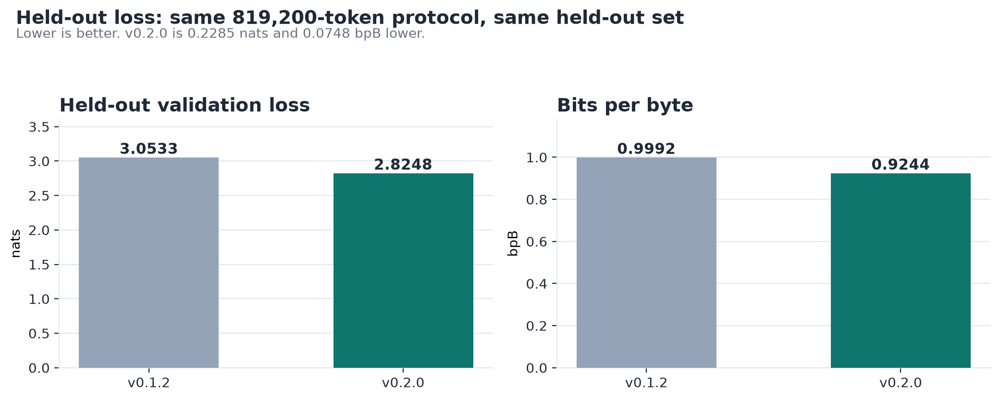
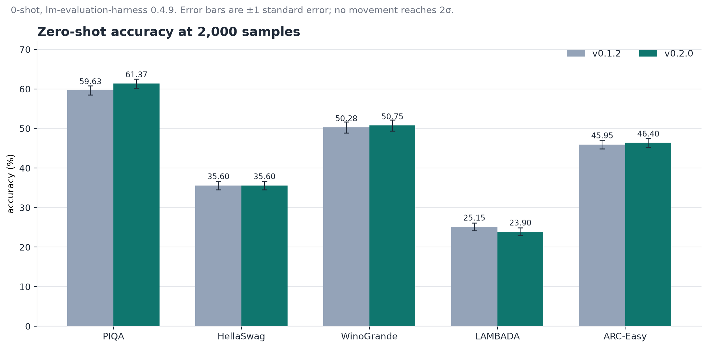
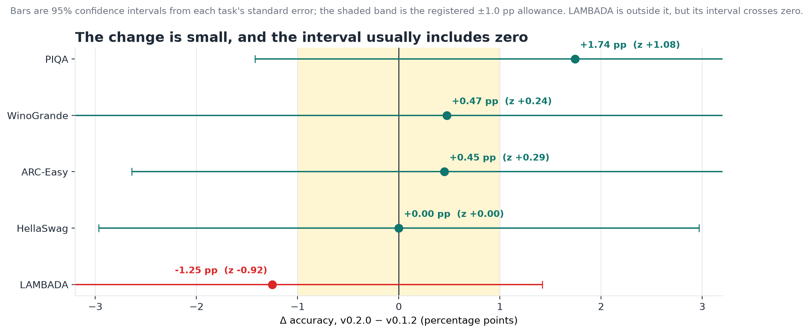
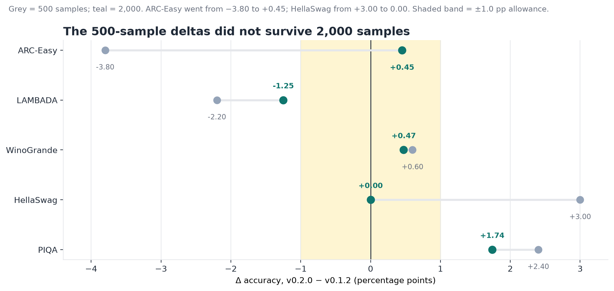

# KALIA v0.2.0

A 57,856,256-parameter language model trained from **random initialization** on
free Kaggle GPUs. No pretrained weights, no fine-tuning, no distillation, no
budget.

This is an **experiment release, not a promotion**. It improves held-out loss on
the pre-registered primary metric. The registered 500-sample stability rule
fails on two benchmarks; at the 2026-10-21 **2,000-sample re-measurement**, only
**LAMBADA** remains outside the 1.0-point allowance (−1.25 points, z = −0.92),
ARC-Easy is **+0.45**, and no movement reaches 2σ. Under the registered rule,
the previous release, [kalia-v012](https://huggingface.co/kalia-lm/kalia-v012),
remains the recommended checkpoint.

```python
from transformers import AutoModelForCausalLM, AutoTokenizer

tok = AutoTokenizer.from_pretrained("kalia-lm/kalia-v020")
model = AutoModelForCausalLM.from_pretrained(
    "kalia-lm/kalia-v020", trust_remote_code=True
)
ids = tok("Once upon a time", return_tensors="pt")
print(tok.decode(model.generate(**ids, max_new_tokens=80)[0]))
```

## What changed from v0.1.2

Only the training data. The architecture, optimizer, schedule and seed are
identical, and the run completed its full 4,770-step schedule where v0.1.2
stopped at 3,478 on quota.

The corpus was rebuilt shard by shard for licence compliance. That rebuild
replaced the held-out set, so **both** versions were re-measured on the new set
before anything was compared — the earlier 2.4366 figure is v0.1.2 on the old
set and is never placed beside these numbers.

## Results

### Held-out loss

The primary metric is deterministic held-out loss: 100 batches × 8 sequences ×
1,024 tokens = 819,200 tokens, seed 1234, the same call that produced v0.1.2's
reference.

v0.1.2 scored **3.0533** val loss and **0.9992** bits-per-byte. v0.2.0 scored
**2.8248** and **0.9244**.

That is **0.2285 nats better — 4.6× the pre-registered 0.05-nat bar**. Both
thresholds existed as a hashed file before the run finished.

| Metric | v0.1.2 | v0.2.0 | Δ |
|---|---|---|---|
| Validation loss | 3.0533 | **2.8248** | −0.2285 |
| Bits per byte | 0.9992 | **0.9244** | −0.0748 |



### Zero-shot accuracy

Measured with lm-evaluation-harness 0.4.9, 0-shot, at **2,000 samples** on
2026-10-21. Both checkpoints were scored in one CPU session. PIQA used its full
1,838 validation items and WinoGrande its full 1,267; the other three tasks used
2,000. Standard errors at this size are about 1.0–1.4 percentage points.

| Task | v0.1.2 | v0.2.0 | Δ (pp) | z | S-A (≤1.0 pp) |
|---|---|---|---|---|---|
| PIQA | 59.63 | 61.37 | +1.74 | 1.08 | pass |
| HellaSwag | 35.60 | 35.60 | 0.00 | 0.00 | pass |
| WinoGrande | 50.28 | 50.75 | +0.47 | 0.24 | pass |
| LAMBADA | 25.15 | 23.90 | **−1.25** | −0.92 | **fail** |
| ARC-Easy | 45.95 | 46.40 | +0.45 | 0.29 | pass |



**No movement reaches 2σ.** LAMBADA is the only task outside the registered
1.0-point allowance, by 0.25 points (z = −0.92).



The original 500-sample evaluation remains in the record. Its ARC-Easy −3.80
and HellaSwag +3.00 did not survive 2,000 samples; the 500-sample standard error
was about 2 points (D45).



### Why LAMBADA moved down

A document-length probe run on the real mixture before training finished
measured that only **17.7% of training tokens sit inside a document at least as
long as the 1,024-token context**, and that TinyStories — a fifth of the mixture
— supplies **0.03%** of them. LAMBADA asks a model to hold a discourse and
recall its final word, which is exactly what that corpus cannot teach. The probe
also found a candidate replacement source at 99.3%. The mixture remains the open
lever.

## Architecture

| Field | Value |
|---|---|
| Parameters | 57,856,256 |
| Architecture | Pre-norm decoder-only: RMSNorm, SwiGLU, RoPE, QK-Norm, logit soft-cap (τ = 30), tied embeddings, no biases |
| Layers / heads / dim | 10 / 8 / 512 |
| Context | 1,024 tokens |
| Vocabulary | 50,257 (GPT-2 BPE) |
| Optimizer | Muon (Newton–Schulz) on hidden matrices; AdamW on embeddings, head and norms |
| Schedule | Cosine, 500 warmup steps, 4,770 total steps |
| Training | 2,500,853,760 tokens, 6.35h final session, 2× NVIDIA T4 via DDP, ~30 GPU-hours/week free quota |

## Training data

The mixture is 2.4B training tokens plus 10M held out:

| Source | Share | v0.1.2 corpus | v0.2.0 corpus | Licence |
|---|---|---|---|---|
| FineWeb-Edu dedup (`HuggingFaceTB/smollm-corpus`) | 60% | `kalia-prep-v2` | `kalia-prep-v2b` | ODC-By-1.0 |
| TinyStories (`roneneldan/TinyStories`) | 20% | `kalia-prep-v2` | `kalia-prep-v2b` | CDLA-Sharing-1.0 |
| Cosmopedia v2 (`HuggingFaceTB/cosmopedia`) | 15% | `kalia-prep-v2` | `kalia-prep-v2b` | Apache-2.0 |
| Python (`codeparrot/codeparrot-clean`) | 5% | `kalia-prep-v2`, unfiltered | `kalia-prep-v2b`, per-file permissive filter | Mixed; see below |
| GPT-2 BPE tokenizer (`openai/tiktoken`) | — | same | same | MIT |

The text sources are unchanged between the two corpora; the rebuild's material
change is the Python slice. v0.1.2 trained without a licence filter; v0.2.0
rebuilt that slice with a per-file permissive filter and is licence-clean by
construction. The unfiltered bytes are disclosed on the
[v0.1.2 card](https://huggingface.co/kalia-lm/kalia-v012), where a 20,000-file
sample measured 41.7% of characters under copyleft licences, and they are never
redistributed.

### Released corpus shards

This repository publishes the five shards the continual-update experiments are
scored against: the four equalised per-source shards and the pinned probe set.
The full 2.4B-token training mixture is **not** redistributed. Each source shard
is 124,500,691 tokens, equalised because the mixture sampler requires
equal-length shards. Each skips its source's proportional validation head
(6M, 2M, 1.5M and 0.5M tokens respectively), so the canonical held-out set
cannot appear in them.

- **`corpus/fineweb.bin`** — 124,500,691 tokens of FineWeb-Edu dedup from the
  SmolLM corpus. ODC-By-1.0; credit `HuggingFaceTB/smollm-corpus`.
- **`corpus/tinystories.bin`** — 124,500,691 tokens of TinyStories.
  CDLA-Sharing-1.0. The licence terms are unmodified; the bytes are tokenized
  uint16 with an EOS separator between documents, not the raw source text.
  Credit `roneneldan/TinyStories`.
- **`corpus/cosmopedia.bin`** — 124,500,691 tokens of Cosmopedia v2 via the
  SmolLM corpus. Apache-2.0 content card; the ODC-By container is also credited.
- **`corpus/python.bin`** — 124,500,691 tokens of Python, filtered per file to
  seven permissive licences by `prepare.py::is_permissive_license`.
- **`corpus/probe_val.bin`** — 1,000,000 tokens: the frozen first million tokens of the v0.2.0 **training** stream. It is deliberately not held-out data and is not the canonical validation set. Per source, as above.
- **`corpus/manifest.json`** — source paths, ratios and per-shard SHA-256.

Per-file licences and attribution links are in
[`corpus/NOTICE.md`](https://huggingface.co/kalia-lm/kalia-v020/blob/main/corpus/NOTICE.md)
(the repository's `docs/legal/corpus-shard-notice.md`).

The bytes are the licence-filtered build — code from `kalia-prep-v2b`, text
sources unchanged — so **no copyleft text is redistributed**. The recipe that
regenerates the full corpus, including the mix config, `prepare.py` and the
licence filter, is in the
[repository](https://github.com/subhajitlucky/kalia). CDLA-Sharing §3.5 places
Results (the weights) beyond any obligation, and the sharing licence grants the
right to train outright.

## Limitations

- **Small and domain-narrow.** Coherent short-form English; children's stories
  and educational text. Not a general assistant, and there is no instruction
  tuning yet.
- **Long-range recall is weak.** LAMBADA is the only task outside the
  1.0-point allowance at 2,000 samples (−1.25, z = −0.92); see the note above.
- **Training plateaus.** Validation loss is flat across the final 1,500 of 4,770
  steps (spread 0.065 nats over seven evaluations). The last 31% of training
  produced no measurable gain. Fixing that is the point of the next version.
- **Not continual yet.** This is a completed from-scratch base. v0.3.0 is
  planned as the first continual update of it: new data, learning rate re-warmed
  and re-decayed, old data replayed, no restart.
- May produce inaccurate or biased text. Not for production decisions.

## Reproducibility and provenance

- Weights were exported from the step-4,770 training checkpoint and **verified
  by re-scoring the published `model.safetensors`** under the registered
  protocol. The export is only valid if it reproduces 2.8248. The tensors are
  bitwise-identical to the checkpoint.
- The published `config.json` is derived from the checkpoint's own
  configuration, not transcribed.
- `logs/train_log.csv` (477 rows, steps 10–4770) and `logs/val_log.csv` (19 rows)
  are included.
- The `corpus/` shards and probe set are hash-pinned: every published shard's
  SHA-256 matches `corpus/manifest.json` and the repository's
  `docs/legal/val-shard-hashes.json`.
- Every decision, incident and pre-registration behind these numbers is in the
  [repository](https://github.com/subhajitlucky/kalia), with
  [`docs/SYNTHESIS.md`](https://github.com/subhajitlucky/kalia/blob/main/docs/SYNTHESIS.md)
  as the single-document summary. Pre-registration hashes verify with
  `python tools/verify_prereg_ledger.py`.

## Citation

```bibtex
@misc{kalia2026v020,
  author = {Subhajit Pradhan},
  title  = {KALIA v0.2.0: a 58M from-scratch language model, and the measurement errors that came with it},
  year   = {2026},
  note   = {Held-out loss improves 0.2285 nats over v0.1.2. At 2,000 samples, one of five zero-shot benchmarks (LAMBADA) is outside the 1.0 pp allowance; the 500-sample ARC-Easy regression did not replicate and no movement reaches 2 sigma. Pre-registered, and reported as measured.}
}
```

## License

Code: MIT. Model weights: Apache-2.0. See [`LICENSE`](./LICENSE).
