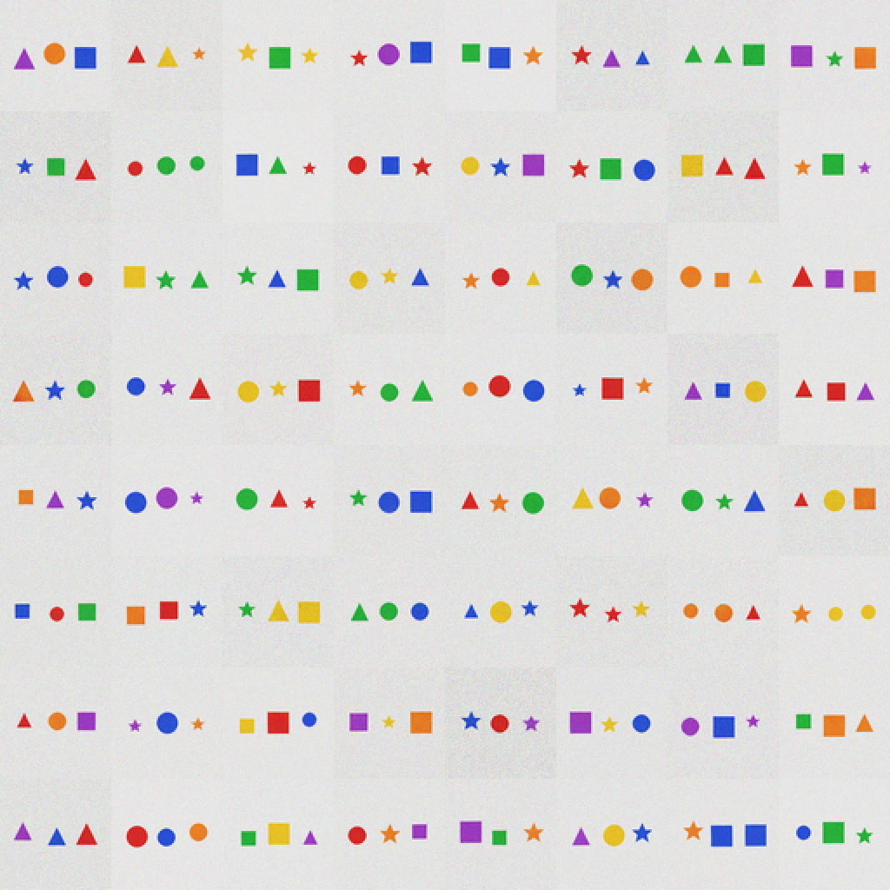

# v0.10.0-selfverify — KALIA critiques its own drawings

**Capability release — 2026-11-09.** KALIA samples several candidate images,
reads each one back with its frozen captioner, and keeps the one that best
matches what it meant to draw. No external reward model, no human labels, no
distillation — the model is its own critic.

## Result

| dataset | N=1 | selected | oracle | verifier readback | gain |
|---|---:|---:|---:|---:|---:|
| **64×64 three-object** (n=990) | 0.781 | **0.953** | 0.994 | 0.994 | **+17.2 pp** |
| **32×32 two-object** (n=1,000) | 0.943 | **0.991** | 1.000 | 1.000 | **+4.8 pp** |

- S-1…S-4 pass.
- 8× inference compute; the captioner is the critic; an independent classifier
  is the judge and is not used for selection.
- No training; frozen v0.3.1, v1/v3 diffusion, v2.1/X58 captioner.

## What changed

At 58M, **perception is a better critic than the language model**. The text
log-prob verifier failed best-of-N (0.547 vs 0.828 greedy), but the captioner
selects 64×64 candidates at 0.953 and 32×32 at 0.991. The see→draw→see loop
becomes **see→draw→judge→choose**.

This makes the 64×64 three-object diffusion usable (0.953 selected) without a
larger diffusion, and pushes the 32×32 toy to 0.991.

## What is released

- `tools/kalia_x60_selfverify_kernel.py` — the mechanism.
- `docs/results/x60-selfverify/` — metrics, selected grids, log.
- Pre-registration: `docs/preregistrations/2026-11-09-X60-selfverify.md`.

## Caveat

Synthetic 32×32/64×64 grids; 8× sampling; selected images are not perfect
(0.953/0.991). This is a capability pack, not a standard-benchmark gain. The
public base remains **v0.3.1**; no Hugging Face base release, because the
standard-benchmark +10% gate is not met.

## Record

- Result: `docs/results/x60-selfverify/README.md`
- Pre-registration: `docs/preregistrations/2026-11-09-X60-selfverify.md`
- Licence: repository `LICENSE`.
