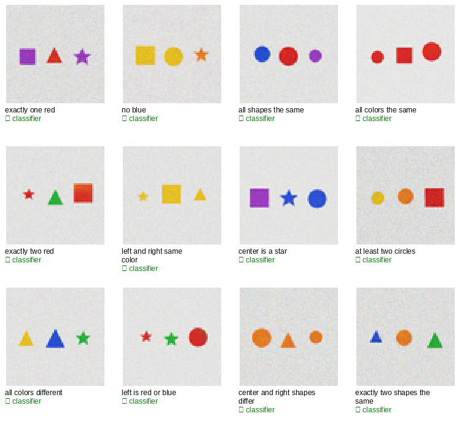

# v0.11.0-constraints — KALIA satisfies visual constraints

**Capability release — 2026-11-09.** Given a compositional constraint, KALIA
samples 64 candidate scenes, reads each back with its frozen captioner, and
keeps the first that satisfies the constraint. The independent classifier
agrees on **97.2%** of the satisfied scenes.

## Result

- Mean success **0.993** (119/120 trials); **11/12** constraints at **1.000**;
  “exactly two red” 0.917.
- Classifier agreement **0.972**.
- Rare constraints are solved by search: “all colors the same” needs ~24
  candidates on average and succeeds in 12/12 trials.
- No training; 64 candidates/trial; 12 trials/constraint.
- CS-1…CS-4 pass.

| constraint | success | classifier agreement |
|---|---:|---:|
| exactly one red | 1.000 | 0.917 |
| no blue | 1.000 | 1.000 |
| all shapes the same | 1.000 | 0.917 |
| all colors the same | 1.000 | 0.917 |
| exactly two red | 0.917 | 1.000 |
| left and right same color | 1.000 | 0.917 |
| center is a star | 1.000 | 1.000 |
| at least two circles | 1.000 | 1.000 |
| all colors different | 1.000 | 1.000 |
| left is red or blue | 1.000 | 1.000 |
| center and right shapes differ | 1.000 | 1.000 |
| exactly two shapes the same | 1.000 | 1.000 |
| **mean** | **0.993** | **0.972** |

## What changed

X60 showed KALIA can pick the best of its own drawings. X62 turns that into a
**goal-directed search**: the constraint is a predicate on the captioner’s
readback, and the model samples until it finds a scene that satisfies it. No
external reward model, no human labels, no rule-based filter in generation.

## What is released

- `tools/kalia_x62_constraints_kernel.py` — the mechanism.
- `docs/results/x62-constraints/` — metrics, gallery, samples, log.
- Pre-registration: `docs/preregistrations/2026-11-09-X62-constraints.md`.

## Caveat

Synthetic 64×64 three-object grid; 64 candidates per trial; the captioner is
the verifier and the classifier is the independent judge. The success is
measured on the captioner’s readback; not a general-vision claim. The public
base remains **v0.3.1**; no Hugging Face base release, because the
standard-benchmark +10% gate is not met.

## Record

- Result: `docs/results/x62-constraints/README.md`
- Pre-registration: `docs/preregistrations/2026-11-09-X62-constraints.md`
- Licence: repository `LICENSE`.
