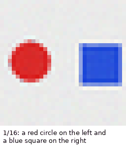
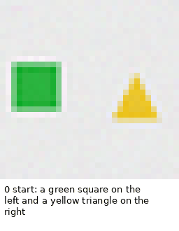
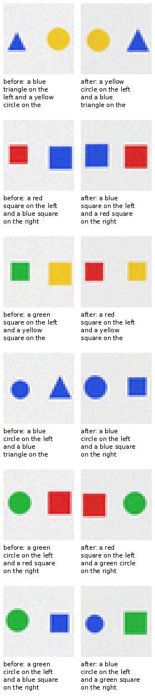

# v0.8.0-imagine — KALIA’s visual imagination toy

**Capability/demo release — 2026-11-08.** A from-scratch 58M multimodal toy:
it morphs between scenes, dreams a chain of word edits, and edits a real
synthetic scene with words. No training; frozen v0.3.1 + v1 diffusion + v2.1
captioner.

## Result

| bar | result |
|---|---|
| **I-1** morph endpoint exact over 12 endpoints | **0.917** (11/12) |
| **I-2** edit survival over 24 edits | **0.958** (23/24) |
| **I-3** dream edit survival over 10 steps | **1.000** (10/10) |
| **I-4** gallery artifacts | **PASS** |
| **I-5** from scratch; no external weights/distillation | **PASS** |

- Real caption exact on six real synthetic scenes: **1.000**.
- Morph: 16 frames, red circle / blue square → yellow triangle / green circle.
- Dream: 10 coherent steps; the scene evolves through color/shape/side edits.
- Edit: 6 real scenes × 4 edits; one swap-colors miss.

## What changed

This is not a new base model and not a benchmark gain. It is a **composition**
of the modules already in the repo:

- the v2.1 captioner reads a 32×32 scene;
- the v1 diffusion draws from a caption embedding;
- the corrected bidirectional text conditioning makes the loop coherent;
- a deterministic caption editor supplies the word-level interventions.

The result is a small visual imagination toy: you can morph two scenes, let it
dream a chain of edits, or edit a real synthetic scene with words.

## What is released

- `imagine.py` — the toy (`gallery`, `morph`, `dream`, `edit` modes).
- `docs/results/kalia-imagine/` — GIFs, before/after grid, metrics.
- Pre-registration: `docs/preregistrations/2026-11-08-X57-imagine.md`.

## Caveat

32×32 two-object scenes: three shapes, four colors, two positions. The caption
editor is deterministic code; the learned parts are the captioner and the
diffusion. This is a visual toy, not general vision and not a chat model. The
public base remains **v0.3.1**; no Hugging Face base release, because the
standard-benchmark +10% gate is not met.

## Record

- Result: `docs/results/kalia-imagine/README.md`
- Pre-registration: `docs/preregistrations/2026-11-08-X57-imagine.md`
- Licence: repository `LICENSE`.
