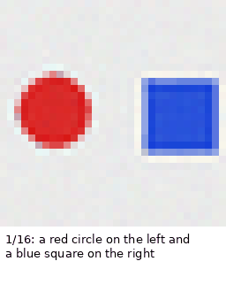
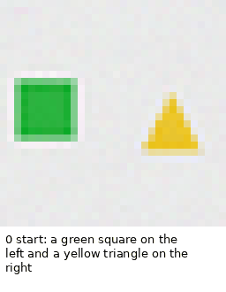
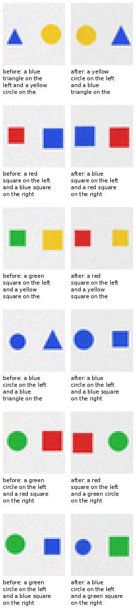

# KALIA-Imagine — visual morph / dream / edit toy

Status: **clean pass of I-1…I-5.** A from-scratch 58M multimodal toy: it morphs
between scenes, dreams a chain of word edits, and edits a real synthetic scene
with words. No training; frozen v0.3.1 + v1 diffusion + v2.1 captioner.







## Result

| bar | result |
|---|---|
| **I-1** morph endpoint exact over 12 endpoints | **0.917** (11/12) |
| **I-2** edit survival over 24 edits | **0.958** (23/24) |
| **I-3** dream edit survival over 10 steps | **1.000** (10/10) |
| **I-4** gallery artifacts | **PASS** |
| **I-5** from scratch; no external weights/distillation | **PASS** |

- Real caption exact on the six real synthetic scenes: **1.000**.
- Morph: 16 frames from “a red circle on the left and a blue square on the
  right” to “a yellow triangle on the left and a green circle on the right.”
- Dream: 10 steps; the chain stays coherent:
  `green square / yellow triangle` → invert colors → red square / blue triangle
  → change left color to green → … → swap sides → `yellow square / blue square`.
- Edit: 6 real scenes × 4 edits. The single miss was a swap-colors case where
  the readback turned a yellow triangle into a yellow circle.

## How it works

- **Morph:** interpolate the 512-d bidirectional caption embeddings between
  two scenes; draw each frame with the 100-step DDIM sampler; read each frame
  back with the captioner.
- **Dream:** start from a scene; apply a random deterministic caption edit
  (swap sides/colors/shapes, change a color/shape, make both the same, invert
  colors); draw the edited caption; read it back; repeat 10 times.
- **Edit:** real synthetic scene → caption → word edit → draw → caption.

The caption editor is deterministic code written here. The learned parts are
the captioner and the diffusion; the text trunk is KALIA v0.3.1. No external
vision weights, no external model inference, no distillation.

## Caveat

32×32 two-object scenes: three shapes, four colors, two positions. This is a
visual toy, not general vision and not a chat model. It is not a
standard-benchmark gain; the public base remains **v0.3.1**.

## Reproduce

```bash
python imagine.py --mode gallery --out docs/results/kalia-imagine
python imagine.py --mode morph --start "..." --end "..." --frames 16
python imagine.py --mode dream --seed "..." --steps 10
```

## Artifacts

- `morph.gif`, `morph_frames.png`, `morph.json` — 16-frame morph.
- `dream.gif`, `dream.json` — 10-step dream chain.
- `edit_grid.png` — 6 before/after scene edits.
- `metrics.json` — endpoint exact, edit survival, dream survival, examples.
- `imagine.py` — the toy.
- Pre-registration: `docs/preregistrations/2026-11-08-X57-imagine.md`
  (hash `9b34c9be…`).
