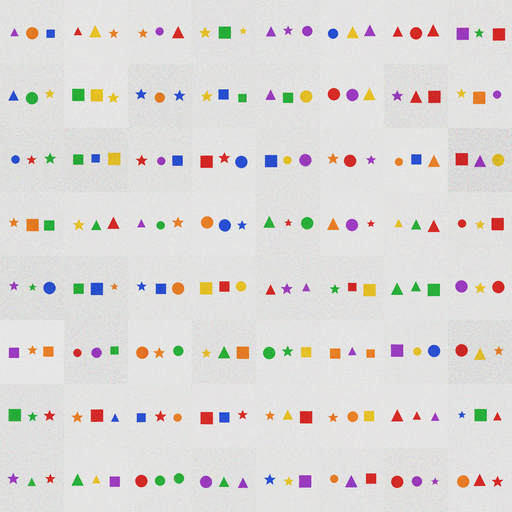

# X59 — 64×64 three-object large diffusion: still short

Status: **X59-1 fails (0.758 vs 0.80).** The larger 8.7M U-Net improves the
generated-scene exact by **+6.3 pp** over the 3.75M model, but it does not clear
the bar. No `v0.9.0-vision-64` release; **v0.8.0-imagine** (32×32) stands.

## Result

- **UNetLarge:** 8,708,451 params — 96/192/384 channels plus an 8×8
  self-attention bottleneck (8 heads).
- 30,000 steps, batch 64, **200.5 minutes**.
- Real-image classifier exact **0.975**.
- Generated-image exact **0.758**; attributes 0.900–0.971 (weakest: center
  color 0.900).
- X58 3.75M U-Net: **0.695**; X59 8.7M: **0.758** — capacity helps
  monotonically, but the task remains sub-threshold.

| bar | result |
|---|---|
| **X59-1** generated-scene exact ≥ 0.80 | **FAIL (0.758)** |
| **X59-2** see→draw→see loop ≥ 0.80 | not run — quality bar failed first |
| **X59-3** edit survival ≥ 0.70 | not run — quality bar failed first |
| **X59-4** from scratch; artifacts | **PASS** |

## Interpretation

The 64×64 three-object task is beyond the 8.7M diffusion at 30k steps/batch 64.
The center object/color remains the weakest. A 15–20M model or a longer
schedule might clear 0.80, but the remaining quota is **6.3h** and the trend
suggests diminishing returns. The cheaper 64×64 path is a **two-object grid**,
not another three-object capacity run.

## Decision

No `v0.9.0-vision-64` release. **v0.8.0-imagine** (32×32) remains the released
toy. No tuning after the result. If a 64×64 toy is wanted, pre-register a
two-object 64×64 grid as a new experiment.

## Artifacts

- `ckpt.pt` — 34.9MB UNetLarge checkpoint.
- `classifier.pt` — 6-head quality classifier.
- `grid.png` — 64 generated held-out scenes.
- `train_manifest.json` — generated/real exact, params, time.
- `x59.log` — run log.
- Pre-registration: `docs/preregistrations/2026-11-09-X59-vision-64-large.md`
  (hash `080f7fb9…`).
