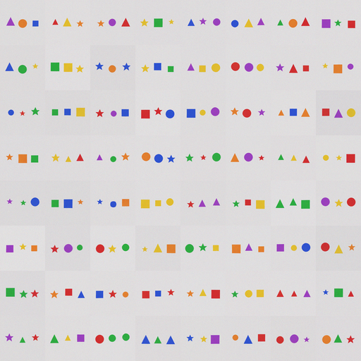

# X58 — 64×64 three-object vision: mixed / boundary

Status: **captioner passes V64-1/V64-2; diffusion fails V64-3 (0.695 vs 0.80).**
No `v0.9.0-vision-64` release. The 32×32 **v0.8.0-imagine** toy remains the
released capability.

## Result

### Captioner — pass

- 64×64, three objects, four shapes, six colors, left/center/right.
- 20% of the 13,824 combinations held out (2,765); 11,059 seen.
- Held-out exact **0.997**, seen exact **0.999**.
- Held-out attributes: 0.998–1.000.
- Blind **0.000**, shuffled-image **0.000**.
- 2,328,832 trainable (CNN encoder + LoRA); 8 epochs, ~34 min.
- Checkpoint `ckpt_captioner.pt`, 9.3MB, sha `0efcda0a…`.

### Diffusion — fail

- v1 U-Net architecture, 3,748,035 params, trained from scratch at 64×64.
- 30,000 steps, batch 64, **121 minutes**.
- Real-image classifier exact **0.979** (sanity).
- Generated-image exact **0.695**; bar **0.80** → **FAIL**.
- Generated attributes: 0.878–0.955 (weakest: center color 0.878).
- Training loss fell to **0.001–0.01**, so this is not undertraining. The
  3.75M U-Net is capacity-limited for three objects at 64×64.
- Checkpoint `ckpt.pt`, 15.0MB, sha `7bb66f50…`.

| bar | result |
|---|---|
| **V64-1** captioner held-out ≥ 0.90 | **PASS (0.997)** |
| **V64-2** captioner seen ≥ 0.95 | **PASS (0.999)** |
| **V64-3** diffusion classifier ≥ 0.80 | **FAIL (0.695)** |
| **V64-4** loop ≥ 0.80 | not run — quality bar failed first |
| **V64-5** edit survival ≥ 0.70 | not run — quality bar failed first |
| **V64-6** from scratch | **PASS** |

## Interpretation

The captioner scales cleanly: it composes unseen three-object combinations at
0.997 exact. The bottleneck is the **diffusion**. The 3.75M U-Net fits the
training loss but does not generate clean three-object 64×64 scenes; the
center object is the weakest. This is a capacity boundary, not a data or
optimization failure.

No tuning after the result. A 64×64 toy would need a larger diffusion
(10–15M params) or a simpler 2-object 64×64 grid; both are new experiments.

## Artifacts

- `ckpt.pt` — 64×64 diffusion U-Net.
- `ckpt_captioner.pt` — 64×64 captioner encoder + LoRA.
- `classifier.pt` — 6-head quality classifier.
- `grid.png` — 64 generated held-out scenes.
- `grid_eval.png` — 64 real held-out scenes.
- `metrics.json` — captioner eval.
- `train_manifest.json` — diffusion/classifier metrics.
- `kalia-x58-diffusion-64.log`, `kalia-x58-captioner-eval.log`.
- Pre-registration: `docs/preregistrations/2026-11-08-X58-vision-64.md`
  (hash `f0df78d7…`).
