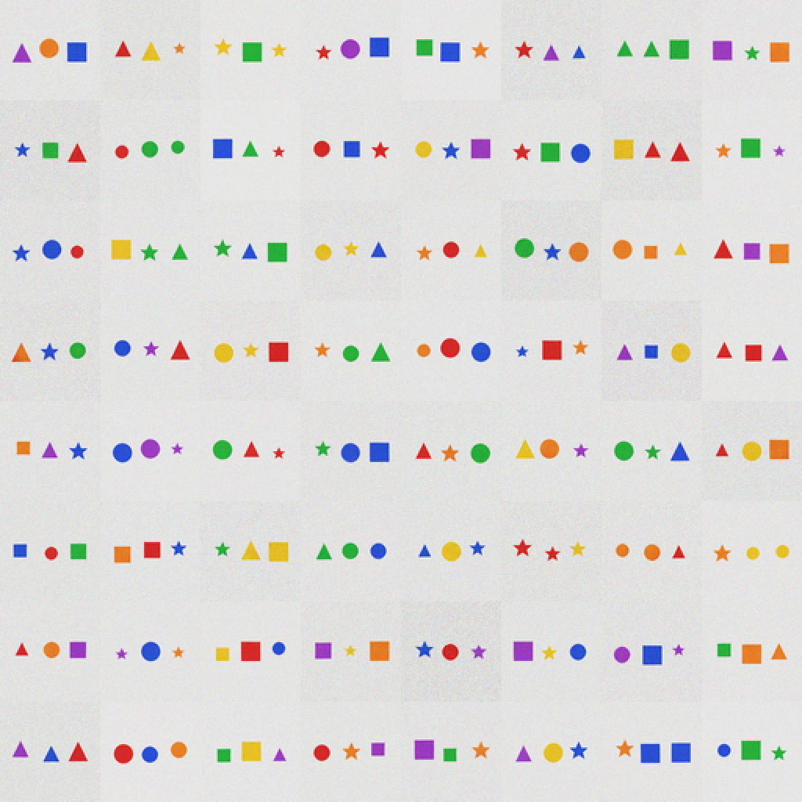

# X60 — self-verifying visual generation

Status: **clean pass of S-1…S-4.** The model samples 8 candidates per caption,
reads each with its frozen captioner, keeps the one whose teacher-forced CE of
the target is lowest, and an **independent classifier** judges the result.

## Result

| dataset | N=1 | selected | oracle | verifier readback | gain |
|---|---:|---:|---:|---:|---:|
| **64×64 three-object** (n=990) | 0.781 | **0.953** | 0.994 | 0.994 | **+17.2 pp** |
| **32×32 two-object** (n=1,000) | 0.943 | **0.991** | 1.000 | 1.000 | **+4.8 pp** |

| bar | result |
|---|---|
| **S-1** 64×64 selected ≥ 0.90 | **PASS (0.953)** |
| **S-2** 32×32 selected ≥ 0.98 | **PASS (0.991)** |
| **S-3** gain ≥ +0.10 / +0.03 | **PASS (+0.172 / +0.048)** |
| **S-4** no external reward; from scratch | **PASS** |

- No training. Frozen v0.3.1, v1/v3 diffusion, v2.1/X58 captioner.
- The captioner is the critic; the classifier is the judge and is **not** used
  for selection.
- 8× inference compute; oracle is any-of-8 exact by the classifier.

## What it means

At 58M, **perception is a stronger critic than the language model**. The text
log-prob verifier failed best-of-N (0.547 selected vs 0.828 greedy), while the
captioner selects 64×64 candidates at 0.953 and 32×32 at 0.991. The model can
look at its own drawings, read them back, and keep the one that matches what it
meant to draw — no reward model, no human labels, no distillation.

This turns the 64×64 three-object diffusion from a sub-threshold generator
(0.758 in X59) into a usable one (0.953 selected) without a larger diffusion.

## Caveat

Synthetic 32×32/64×64 grids; 8× sampling; the selected images are not perfect
(0.953/0.991). This is a capability pack, not a standard-benchmark gain. The
public base remains **v0.3.1**.

## Artifacts

- `metrics.json` — N=1, selected, oracle, verifier, gains, bars.
- `selected_64.png` — 64 chosen 64×64 scenes.
- `selected_32.png` — 64 chosen 32×32 scenes.
- `x60.log` — run log.
- Pre-registration: `docs/preregistrations/2026-11-09-X60-selfverify.md`
  (hash `596cf0a8…`).
- Kernel: `subhajitlucky/kalia-x60-selfverify`.
