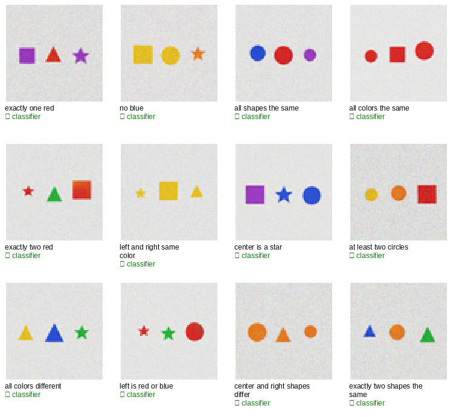

# X62 — constraint-satisfying visual generation

Status: **clean pass of CS-1…CS-4.** Given a compositional constraint, KALIA
samples 64 candidate scenes, reads each back with its frozen captioner, and
keeps the first that satisfies the constraint. The independent classifier
agrees on **97.2%** of the satisfied scenes.

## Result

- Mean success **0.993** (119/120 trials); **11/12** constraints at **1.000**;
  “exactly two red” 0.917 (one miss in 12).
- Classifier agreement **0.972**.
- Search: mean first success 0.17–24.4 candidates; the rare “all colors the
  same” needs 24.4 on average; budget 64.
- No training; 64 candidates/trial; 12 trials/constraint.
- CS-1…CS-4 pass.

| constraint | success | classifier agreement | mean first |
|---|---:|---:|---:|
| exactly one red | 1.000 | 0.917 | 2.3 |
| no blue | 1.000 | 1.000 | 1.0 |
| all shapes the same | 1.000 | 0.917 | 14.2 |
| all colors the same | 1.000 | 0.917 | 24.4 |
| exactly two red | 0.917 | 1.000 | 14.6 |
| left and right same color | 1.000 | 0.917 | 3.7 |
| center is a star | 1.000 | 1.000 | 3.8 |
| at least two circles | 1.000 | 1.000 | 5.4 |
| all colors different | 1.000 | 1.000 | 0.8 |
| left is red or blue | 1.000 | 1.000 | 2.8 |
| center and right shapes differ | 1.000 | 1.000 | 0.2 |
| exactly two shapes the same | 1.000 | 1.000 | 0.8 |
| **mean** | **0.993** | **0.972** | — |

## What it means

The model can be given a compositional goal and search its own imagination for
a scene that satisfies it, using its own captioner as the verifier. No external
reward model, no human labels, no rule-based filter in generation. This is the
see→draw→judge→choose loop applied to **constraint satisfaction**.

The rare constraints are the interesting ones: “all colors the same” needs
~24 candidates on average, and the model finds it in 12/12 trials; the search
is doing real work, not just drawing a common scene.

## Caveat

Synthetic 64×64 three-object grid; 64 candidates per trial; the captioner is
the verifier and the classifier is the independent judge. The success is
measured on the captioner’s readback; this is not a general-vision claim. Public
base remains **v0.3.1**.

## Artifacts

- `metrics.json` — per-constraint success, agreement, oracle, mean-first.
- `constraints.png` — 12 satisfied scenes with the constraint and the
  classifier check.
- `samples.json` — readbacks and classifier status.
- `x62.log` — run log.
- Pre-registration: `docs/preregistrations/2026-11-09-X62-constraints.md`
  (hash `e0b9da8c…`).
- Kernel: `subhajitlucky/kalia-x62-constraints`.
