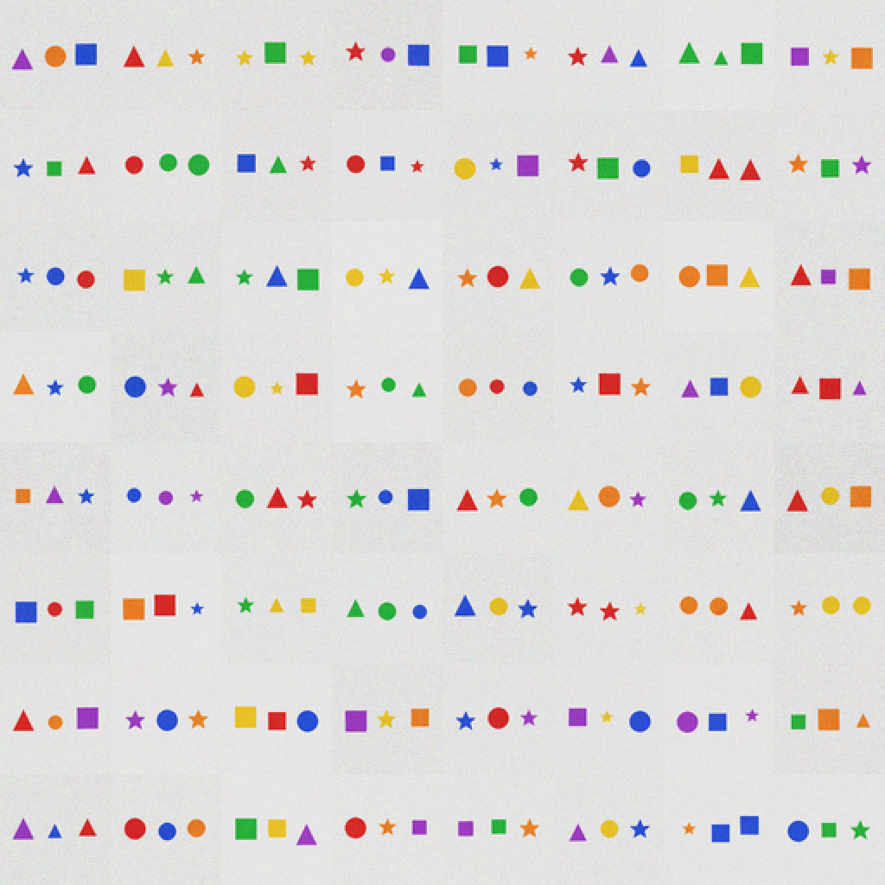

# X63 — two-reader ensemble: null

Status: **E-1/E-2 fail.** A second reader with a different image encoder does
not close the verifier–judge gap.

## Result

- 64×64 three-object, n=990, N=8.
- Single CNN selected exact **0.9556**.
- Ensemble `max(CE_cnn, CE_vit)` **0.9545** (−0.10 pp).
- Ensemble mean **0.9586** (+0.30 pp).
- Oracle **0.9939**.
- ViT reader itself: held-out **0.995**, seen **0.995**, shuffled 0.000.
- E-1 (≥0.97) **fail**; E-2 (+1.5 pp) **fail**; E-3/E-4 pass.

## Interpretation

The two readers share the frozen KALIA decoder and the same training data. A
different image encoder does not make them independent: their errors are
correlated, so the ensemble does not improve selection. The 4.1 pp
captioner–classifier gap is a **shared representation bias**, not a missing
encoder. The oracle 0.9939 shows the candidate pool contains the right image;
selection is the bottleneck.

## Decision

No `v0.12.0-two-readers`. X60 self-verification (0.953) and X62 constraints
(0.993) stand. To close the gap we would need a verifier independent of the
captioner’s decoder and training data, or accept the 0.955 selection. Public
base remains **v0.3.1**.

## Artifacts

- `metrics.json` — single/max/mean/oracle, bars.
- `selected_64.png` — 64 chosen scenes.
- `x63.log` — run log.
- Pre-registration: `docs/preregistrations/2026-11-09-X63-two-readers.md`
  (hash `b84138a0…`).
- Kernel: `subhajitlucky/kalia-x63-two-readers`.
